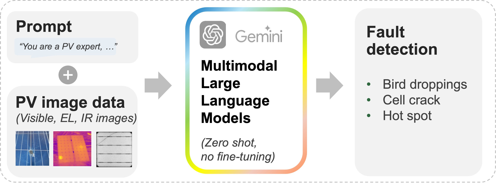
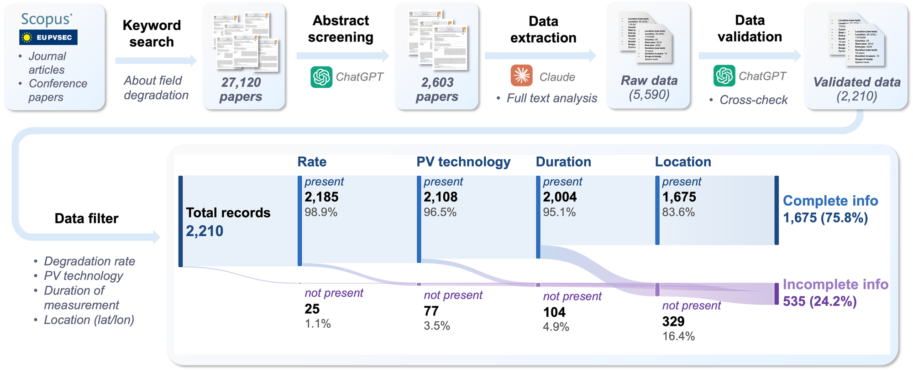
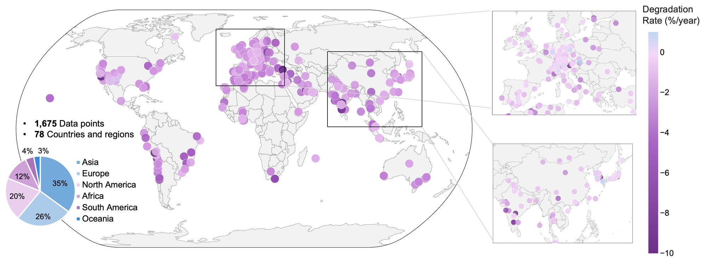
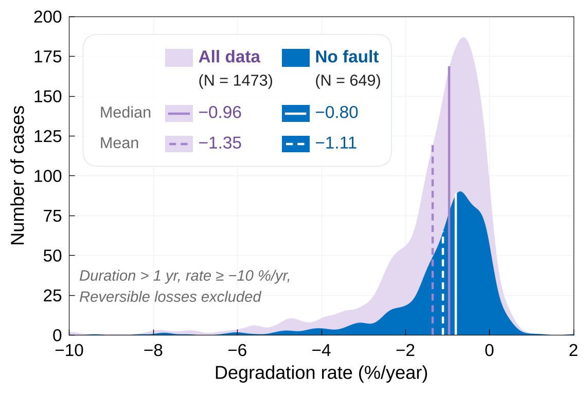
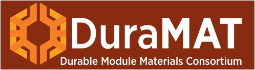

<p align="center">
  
</p>

<p align="center">
  <b>Multimodal large language models for photovoltaic reliability</b><br/>
  PV image diagnostics &nbsp;·&nbsp; Literature mining of field degradation &nbsp;·&nbsp; Automated degradation analysis
</p>

<p align="center">
  <a href="https://datahub-duramat.nlr.gov/data-repo/projects/8c329288-3b34-46ad-9ec5-d62bb06dd664/datasets/9d8e61a8-652b-4de0-949c-dd83010f516d"></a>
  <a href="https://pvtools.lbl.gov/field-degradation"></a>
  <a href="https://github.com/lbj2011/PVCopilot"></a>
</p>

---

## Contents

1. [PV Image Diagnostics](#1-pv-image-diagnostics)
2. [Global PV Field Degradation Database](#2-global-pv-field-degradation-database)
3. [PV-Copilot](#3-pv-copilot)
4. [Acknowledgment](#acknowledgment)

---

## 1. PV Image Diagnostics

One task-aware multimodal LLM pipeline for visible, infrared (IR) and electroluminescence (EL) images, with no task-specific training.

- **Images**: soiling and bird droppings (visible), hot spots (IR), cracks and broken cells (EL)
- **Modes**: zero-shot and few-shot, binary and multiclass
- **Models**: ChatGPT, Gemini, Claude, CLIP

<p align="center">
  
</p>

**Dataset**: [labeled PV image benchmark on DuraMAT DataHub](https://datahub-duramat.nlr.gov/data-repo/projects/8c329288-3b34-46ad-9ec5-d62bb06dd664/datasets/bdac3ba6-8e13-4c24-8fae-86f81b45cd00)

### How to cite

> B. Li and A. Jain, "A unified large language model–based framework for heterogeneous PV image diagnosis," *Solar Energy*, vol. 315, 114801, 2026.

```bibtex
@article{li2026unified,
  title   = {A unified large language model--based framework for heterogeneous PV image diagnosis},
  author  = {Li, Baojie and Jain, Anubhav},
  journal = {Solar Energy},
  volume  = {315},
  pages   = {114801},
  year    = {2026}
}
```

---

## 2. Global PV Field Degradation Database

LLMs read the field-degradation literature and extract every reported annual degradation rate with its context; each record is validated against the source PDF.

| Records | Papers | Countries & regions | Rate extraction accuracy |
|:---:|:---:|:---:|:---:|
| **2,210** | **662** | **78** | **95.9%** |

### Pipeline

- Sources: **Scopus** and **EU PVSEC** papers
- **ChatGPT** abstract screening, **Claude** full-text extraction, **ChatGPT** cross-check
- **1,675** records with complete rate, technology, duration and location

<p align="center">
  
</p>

### Global map

- One point per site, colored by degradation rate
- Most records from **Asia** (35%) and **Europe** (26%)

<p align="center">
  
</p>

### Degradation rate distribution

- Median **−0.96 %/year** for all data (1,473 records)
- Median **−0.80 %/year** without reported faults (649 records)

<p align="center">
  
</p>

### Get the data

- **Download data**: [DuraMAT DataHub](https://datahub-duramat.nlr.gov/data-repo/projects/8c329288-3b34-46ad-9ec5-d62bb06dd664/datasets/9d8e61a8-652b-4de0-949c-dd83010f516d)
- **Column description**: [`field_degradation_dataset/README.md`](field_degradation_dataset/README.md)
- **Interactive map**: [pvtools.lbl.gov/field-degradation](https://pvtools.lbl.gov/field-degradation)

### How to cite

> B. Li, D. C. Jordan, M. Springer, D. Chin, R. Daxini, and A. Jain, "Global PV field degradation database," version 1.0, DuraMAT DataHub, 2026. https://datahub-duramat.nlr.gov/data-repo/projects/8c329288-3b34-46ad-9ec5-d62bb06dd664/datasets/9d8e61a8-652b-4de0-949c-dd83010f516d

```bibtex
@misc{li2026pvfielddegradation,
  title        = {Global PV field degradation database},
  author       = {Li, Baojie and Jordan, Dirk C. and Springer, Martin and Chin, Darren and Daxini, Rajiv and Jain, Anubhav},
  year         = {2026},
  version      = {1.0},
  publisher    = {DuraMAT DataHub},
  howpublished = {\url{https://datahub-duramat.nlr.gov/data-repo/projects/8c329288-3b34-46ad-9ec5-d62bb06dd664/datasets/9d8e61a8-652b-4de0-949c-dd83010f516d}}
}
```

---

## 3. PV-Copilot

Data in, degradation results out: LLM-assisted, end-to-end degradation analysis of PV field data.

- **Automatic column mapping** for uploaded time series
- **Filtering, degradation rates** (YoY, regression, CSD) and **PVPRO** single-diode parameters, built on pvlib and RdTools
- **Simple** (one click) and **Advanced** (step by step) modes, AI code export and diagnostics

<p align="center">
  
</p>

- **Web app**: [pvtools.lbl.gov/pv-copilot](https://pvtools.lbl.gov/pv-copilot)
- **Code**: [github.com/lbj2011/PVCopilot](https://github.com/lbj2011/PVCopilot) · [PyPI: pvcopilot](https://pypi.org/project/pvcopilot/)

### How to cite

> B. Li and A. Jain, "PV Copilot: A large language model–enabled tool for end-to-end PV degradation analysis," in *Proc. 2026 IEEE Photovoltaic Specialists Conference (PVSC)*, 2026.

```bibtex
@inproceedings{li2026pvcopilot,
  title     = {PV Copilot: A large language model--enabled tool for end-to-end PV degradation analysis},
  author    = {Li, Baojie and Jain, Anubhav},
  booktitle = {2026 IEEE Photovoltaic Specialists Conference (PVSC)},
  year      = {2026}
}
```

---

## Acknowledgment



Supported by the **Durable Module Materials (DuraMAT) Consortium**, U.S. Department of Energy.

**Contact**: Baojie Li (baojieli@lbl.gov) · Anubhav Jain (ajain@lbl.gov)
