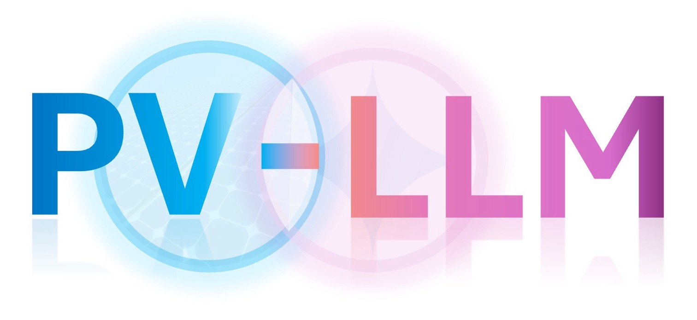
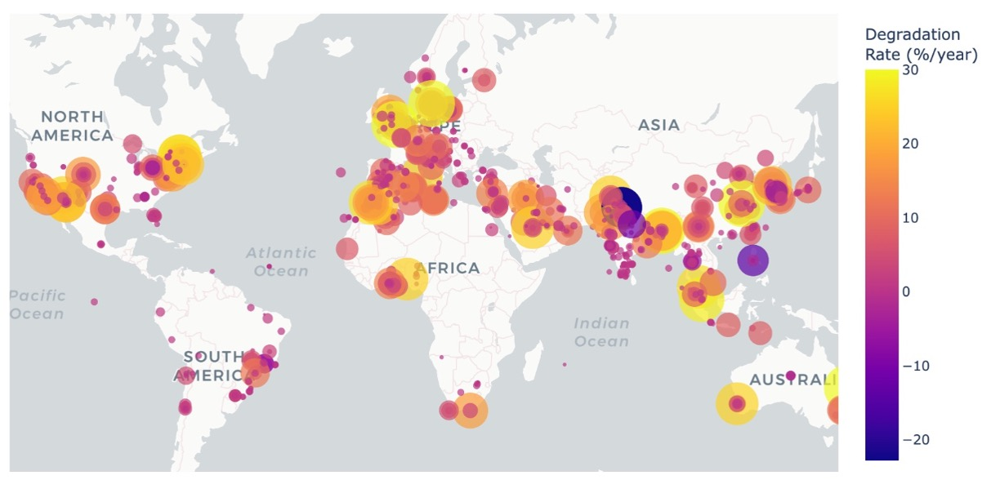

# PV-LLM: Leveraging Multimodal LLMs for PV Analysis

PV-LLM is a novel framework that utilizes **multimodal large language models (LLMs)** to perform advanced analysis in photovoltaics (PV), including **degradation assessment** and **health monitoring**. This project demonstrates how AI can accelerate PV system diagnostics and knowledge extraction from global data sources.

---

## 1. Unified LLM-Based Framework for Heterogeneous PV Image Diagnostics

This project introduces an **open-source multimodal large language model (LLM)–based framework** for automated photovoltaic (PV) image diagnostics across heterogeneous imaging modalities. The framework enables a **single, task-aware inference pipeline** for diverse PV inspection tasks without task-specific model training.

The framework analyzes multiple PV image types, including:

- **Visible images** (bird droppings, surface contamination)
- **Infrared (IR) images** (thermal anomalies, e.g., hotspots)
- **Electroluminescence (EL) images** (microcracks, broken cells)

Key features include **zero-shot and few-shot inference**, **binary and multiclass classification**, and compatibility with state-of-the-art multimodal LLMs (e.g., ChatGPT, Gemini, Claude, CLIP). By eliminating the need for large labeled datasets and retraining, this framework serves as a **rapid pre-screening tool** for scalable PV health monitoring.

**Dataset**: A benchmark dataset of labeled PV images is publicly available at  
https://datahub.duramat.org/dataset/llm-pv-image

**Figure: Multimodal LLM-based PV Image Analysis Flowchart**

---

## 2. Literature Mining: Global PV Field Degradation Database

PV-LLM also performs large-scale **literature mining** with LLMs. Papers are found through Scopus keyword searches, EU PVSEC proceedings and the reference lists of earlier reviews; LLMs screen the papers, extract the reported field degradation rates with their context (PV technology, duration, location, mounting, faults, reversible losses), and every record is validated against the source PDF.

**Database (release v1.0)**: 2,210 field-measured annual degradation rates from 662 papers (1980-2026) in 78 countries and regions.

- **Download**: [DuraMAT DataHub](https://datahub-duramat.nlr.gov/data-repo/projects/8c329288-3b34-46ad-9ec5-d62bb06dd664/datasets/9d8e61a8-652b-4de0-949c-dd83010f516d) (`pv_field_degradation_records.csv`, one row per reported rate)
- **Column description**: [field_degradation_dataset/README.md](field_degradation_dataset/README.md)
- **Interactive map and analysis**: https://pvtools.lbl.gov/field-degradation
- **Extraction accuracy** (independent re-extraction of 303 randomly selected papers, disagreements resolved against the PDF): degradation rate 95.9%, PV technology 97.5%, study scope 97.5%, country 99.3%

**Figure: Global PV Degradation Trends Extracted from Literature**

---

## 3. Funding Acknowledgment

This work is supported by the **Durable Module Materials (DuraMAT) Consortium**, a U.S. Department of Energy initiative focused on PV module reliability and innovation.

---

## Contact

For questions or collaboration opportunities, please contact the PV-LLM development team: baojieli@lbl.gov.

---
